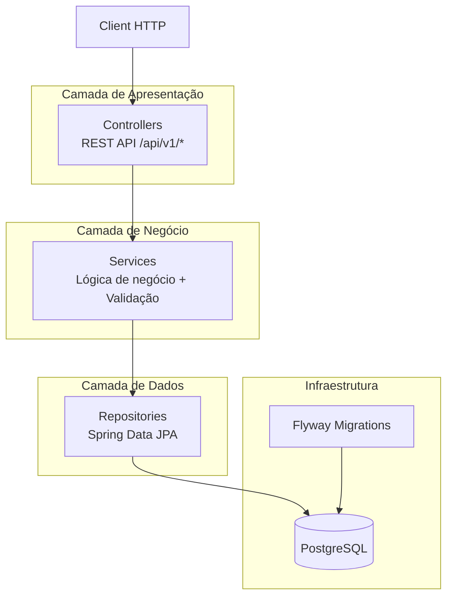
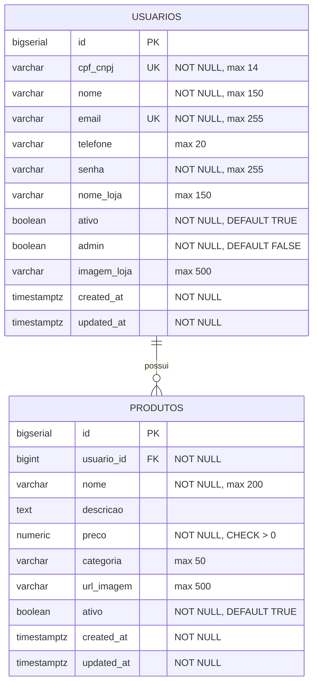
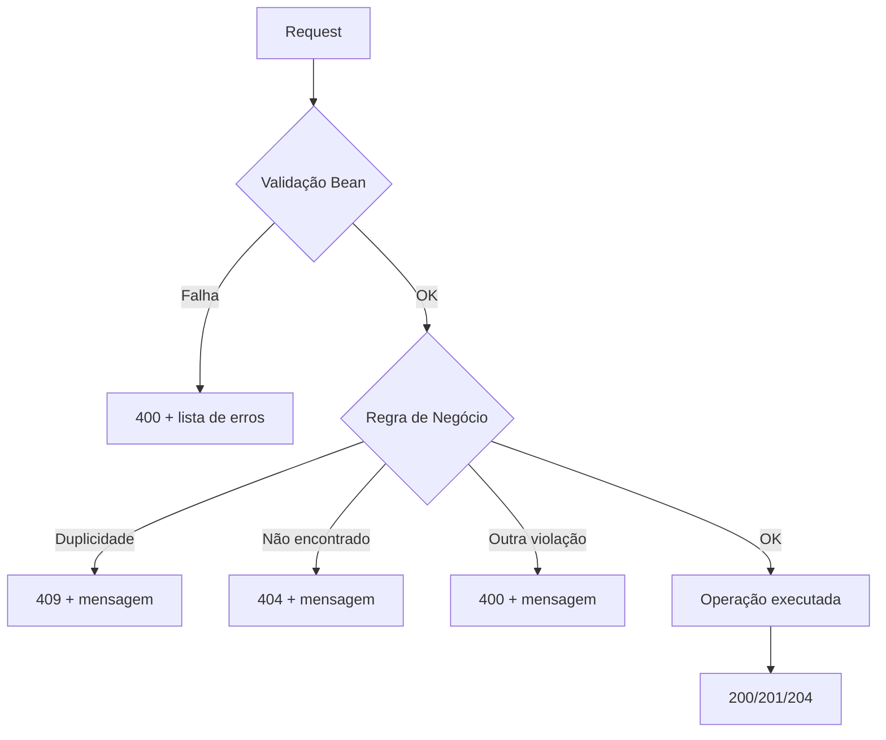

# Design Document — Backend Domain Setup

## Overview

Este documento descreve o design técnico para a configuração do domínio back-end da plataforma Place Offers. O escopo abrange a modelagem das entidades `Usuario` e `Produto`, o enum `Categoria`, a camada de persistência com PostgreSQL (via Flyway migrations), e as operações CRUD expostas via REST API.

A arquitetura segue o padrão de camadas (Controller → Service → Repository) com Spring Boot 3.x e Java 21+, conforme os padrões do projeto. O banco de dados é gerenciado exclusivamente por migrations Flyway, com Hibernate em modo `validate`.

### Decisões de Design

| Decisão | Justificativa |
|---------|---------------|
| Soft delete (campo `ativo`) | Preserva histórico e permite auditoria futura |
| BCrypt para senhas | Padrão da indústria para hashing de passwords |
| Java Records para DTOs | Imutabilidade, concisão e validação integrada |
| FetchType.LAZY | Evita N+1 e carregamentos desnecessários |
| Flyway + ddl-auto: validate | Schema gerenciado por migrations, Hibernate apenas valida |
| Categoria como VARCHAR (não ENUM type) | Facilita adição de novos valores sem migration destrutiva |
| Paginação obrigatória em listagens | Previne problemas de performance com datasets grandes |

## Architecture



### Estrutura de Pacotes

```
com.placeoffers
├── PlaceOffersApplication.java
├── config/
│   └── JpaAuditingConfig.java
├── common/
│   ├── exception/
│   │   ├── ResourceNotFoundException.java
│   │   ├── DuplicateResourceException.java
│   │   ├── BusinessException.java
│   │   └── GlobalExceptionHandler.java
│   └── dto/
│       ├── ErrorResponse.java
│       ├── FieldErrorDto.java
│       └── PageResponse.java
├── usuario/
│   ├── controller/
│   │   └── UsuarioController.java
│   ├── service/
│   │   └── UsuarioService.java
│   ├── repository/
│   │   └── UsuarioRepository.java
│   ├── model/
│   │   └── Usuario.java
│   └── dto/
│       ├── CreateUsuarioRequest.java
│       ├── UpdateUsuarioRequest.java
│       └── UsuarioResponse.java
└── produto/
    ├── controller/
    │   └── ProdutoController.java
    ├── service/
    │   └── ProdutoService.java
    ├── repository/
    │   └── ProdutoRepository.java
    ├── model/
    │   ├── Produto.java
    │   └── Categoria.java
    └── dto/
        ├── CreateProdutoRequest.java
        ├── UpdateProdutoRequest.java
        └── ProdutoResponse.java
```

## Components and Interfaces

### Controller Layer

#### UsuarioController

```java
@RestController
@RequestMapping("/api/v1/usuarios")
@RequiredArgsConstructor
public class UsuarioController {

    private final UsuarioService usuarioService;

    @PostMapping
    ResponseEntity<UsuarioResponse> create(@Valid @RequestBody CreateUsuarioRequest request);

    @GetMapping
    ResponseEntity<PageResponse<UsuarioResponse>> findAll(
        @RequestParam(defaultValue = "0") int page,
        @RequestParam(defaultValue = "20") int size);

    @GetMapping("/{id}")
    ResponseEntity<UsuarioResponse> findById(@PathVariable Long id);

    @PutMapping("/{id}")
    ResponseEntity<UsuarioResponse> update(
        @PathVariable Long id,
        @Valid @RequestBody UpdateUsuarioRequest request);

    @DeleteMapping("/{id}")
    ResponseEntity<Void> delete(@PathVariable Long id);
}
```

#### ProdutoController

```java
@RestController
@RequestMapping("/api/v1/produtos")
@RequiredArgsConstructor
public class ProdutoController {

    private final ProdutoService produtoService;

    @PostMapping
    ResponseEntity<ProdutoResponse> create(@Valid @RequestBody CreateProdutoRequest request);

    @GetMapping
    ResponseEntity<PageResponse<ProdutoResponse>> findAll(
        @RequestParam(defaultValue = "0") int page,
        @RequestParam(defaultValue = "20") int size,
        @RequestParam(required = false) Long usuarioId,
        @RequestParam(required = false) String categoria);

    @GetMapping("/{id}")
    ResponseEntity<ProdutoResponse> findById(@PathVariable Long id);

    @PutMapping("/{id}")
    ResponseEntity<ProdutoResponse> update(
        @PathVariable Long id,
        @Valid @RequestBody UpdateProdutoRequest request);

    @DeleteMapping("/{id}")
    ResponseEntity<Void> delete(@PathVariable Long id);
}
```

### Service Layer

#### UsuarioService

```java
@Service
@RequiredArgsConstructor
@Transactional(readOnly = true)
public class UsuarioService {

    private final UsuarioRepository usuarioRepository;
    private final PasswordEncoder passwordEncoder;

    @Transactional
    public UsuarioResponse create(CreateUsuarioRequest request);

    public PageResponse<UsuarioResponse> findAll(int page, int size);

    public UsuarioResponse findById(Long id);

    @Transactional
    public UsuarioResponse update(Long id, UpdateUsuarioRequest request);

    @Transactional
    public void delete(Long id); // soft delete: ativo = false
}
```

Responsabilidades:
- Validar unicidade de `cpf_cnpj` e `email` (lançar `DuplicateResourceException` se já existir)
- Hash da senha com BCrypt antes de persistir
- Limitar `size` da paginação a no máximo 100
- Converter entidades para DTOs de resposta (excluindo senha)

#### ProdutoService

```java
@Service
@RequiredArgsConstructor
@Transactional(readOnly = true)
public class ProdutoService {

    private final ProdutoRepository produtoRepository;
    private final UsuarioRepository usuarioRepository;

    @Transactional
    public ProdutoResponse create(CreateProdutoRequest request);

    public PageResponse<ProdutoResponse> findAll(int page, int size, Long usuarioId, String categoria);

    public ProdutoResponse findById(Long id);

    @Transactional
    public ProdutoResponse update(Long id, UpdateProdutoRequest request);

    @Transactional
    public void delete(Long id); // soft delete: ativo = false
}
```

Responsabilidades:
- Validar que `usuario_id` referencia um `Usuario` existente e ativo
- Converter `categoria` de string para enum de forma case-insensitive
- Limitar `size` da paginação a no máximo 50
- Derivar `nome_loja` do `Usuario` associado na resposta

### Repository Layer

#### UsuarioRepository

```java
public interface UsuarioRepository extends JpaRepository<Usuario, Long> {

    Page<Usuario> findByAtivoTrue(Pageable pageable);

    boolean existsByCpfCnpj(String cpfCnpj);

    boolean existsByEmail(String email);

    boolean existsByCpfCnpjAndIdNot(String cpfCnpj, Long id);

    boolean existsByEmailAndIdNot(String email, Long id);
}
```

#### ProdutoRepository

```java
public interface ProdutoRepository extends JpaRepository<Produto, Long> {

    Page<Produto> findByAtivoTrue(Pageable pageable);

    Page<Produto> findByUsuarioIdAndAtivoTrue(Long usuarioId, Pageable pageable);

    Page<Produto> findByCategoriaAndAtivoTrue(Categoria categoria, Pageable pageable);

    Page<Produto> findByUsuarioIdAndCategoriaAndAtivoTrue(
        Long usuarioId, Categoria categoria, Pageable pageable);
}
```

### Exception Handling

#### GlobalExceptionHandler

```java
@RestControllerAdvice
public class GlobalExceptionHandler {

    @ExceptionHandler(ResourceNotFoundException.class)
    ResponseEntity<ErrorResponse> handle(ResourceNotFoundException ex); // 404

    @ExceptionHandler(DuplicateResourceException.class)
    ResponseEntity<ErrorResponse> handle(DuplicateResourceException ex); // 409

    @ExceptionHandler(MethodArgumentNotValidException.class)
    ResponseEntity<ErrorResponse> handle(MethodArgumentNotValidException ex); // 400

    @ExceptionHandler(BusinessException.class)
    ResponseEntity<ErrorResponse> handle(BusinessException ex); // 400/422

    @ExceptionHandler(HttpMessageNotReadableException.class)
    ResponseEntity<ErrorResponse> handle(HttpMessageNotReadableException ex); // 400 (invalid enum)
}
```

### DTOs

#### Usuario DTOs

```java
public record CreateUsuarioRequest(
    @NotBlank @Pattern(regexp = "^\\d{11}(\\d{3})?$") String cpfCnpj,
    @NotBlank @Size(min = 3, max = 150) String nome,
    @NotBlank @Email @Size(max = 255) String email,
    @Size(max = 20) String telefone,
    @NotBlank @Size(min = 8, max = 100) String senha,
    @Size(max = 150) String nomeLoja,
    @Size(max = 500) String imagemLoja
) {}

public record UpdateUsuarioRequest(
    @Pattern(regexp = "^\\d{11}(\\d{3})?$") String cpfCnpj,
    @Size(min = 3, max = 150) String nome,
    @Email @Size(max = 255) String email,
    @Size(max = 20) String telefone,
    @Size(min = 8, max = 100) String senha,
    @Size(max = 150) String nomeLoja,
    @Size(max = 500) String imagemLoja
) {}

public record UsuarioResponse(
    Long id,
    String cpfCnpj,
    String nome,
    String email,
    String telefone,
    String nomeLoja,
    Boolean ativo,
    Boolean admin,
    String imagemLoja,
    LocalDateTime createdAt,
    LocalDateTime updatedAt
) {}
```

#### Produto DTOs

```java
public record CreateProdutoRequest(
    @NotNull Long usuarioId,
    @NotBlank @Size(max = 200) String nome,
    String descricao,
    @NotNull @DecimalMin(value = "0.01") @DecimalMax(value = "9999999.99") @Digits(integer = 7, fraction = 2) BigDecimal preco,
    @NotNull String categoria,
    @Size(max = 500) String urlImagem
) {}

public record UpdateProdutoRequest(
    @Size(max = 200) String nome,
    String descricao,
    @DecimalMin(value = "0.01") @DecimalMax(value = "9999999.99") @Digits(integer = 7, fraction = 2) BigDecimal preco,
    String categoria,
    @Size(max = 500) String urlImagem
) {}

public record ProdutoResponse(
    Long id,
    String nome,
    String descricao,
    BigDecimal preco,
    Categoria categoria,
    String urlImagem,
    Boolean ativo,
    String nomeLoja,
    LocalDateTime createdAt,
    LocalDateTime updatedAt
) {}
```

### Configuration

#### JpaAuditingConfig

```java
@Configuration
@EnableJpaAuditing
public class JpaAuditingConfig {
}
```

#### PasswordEncoderConfig

```java
@Configuration
public class SecurityConfig {

    @Bean
    public PasswordEncoder passwordEncoder() {
        return new BCryptPasswordEncoder();
    }
}
```

## Data Models

### Entidade Usuario

```java
@Entity
@Table(name = "usuarios")
@Getter
@Setter
@NoArgsConstructor
@EntityListeners(AuditingEntityListener.class)
public class Usuario {

    @Id
    @GeneratedValue(strategy = GenerationType.IDENTITY)
    private Long id;

    @Column(name = "cpf_cnpj", nullable = false, length = 14, unique = true)
    private String cpfCnpj;

    @Column(nullable = false, length = 150)
    private String nome;

    @Column(nullable = false, length = 255, unique = true)
    private String email;

    @Column(length = 20)
    private String telefone;

    @Column(nullable = false, length = 255)
    private String senha;

    @Column(name = "nome_loja", length = 150)
    private String nomeLoja;

    @Column(nullable = false)
    private Boolean ativo = true;

    @Column(nullable = false)
    private Boolean admin = false;

    @Column(name = "imagem_loja", length = 500)
    private String imagemLoja;

    @CreatedDate
    @Column(name = "created_at", nullable = false, updatable = false)
    private LocalDateTime createdAt;

    @LastModifiedDate
    @Column(name = "updated_at", nullable = false)
    private LocalDateTime updatedAt;

    @Override
    public boolean equals(Object o) {
        if (this == o) return true;
        if (!(o instanceof Usuario other)) return false;
        return id != null && id.equals(other.getId());
    }

    @Override
    public int hashCode() {
        return getClass().hashCode();
    }
}
```

### Entidade Produto

```java
@Entity
@Table(name = "produtos")
@Getter
@Setter
@NoArgsConstructor
@EntityListeners(AuditingEntityListener.class)
public class Produto {

    @Id
    @GeneratedValue(strategy = GenerationType.IDENTITY)
    private Long id;

    @ManyToOne(fetch = FetchType.LAZY)
    @JoinColumn(name = "usuario_id", nullable = false)
    private Usuario usuario;

    @Column(nullable = false, length = 200)
    private String nome;

    @Column(columnDefinition = "TEXT")
    private String descricao;

    @Column(nullable = false, precision = 10, scale = 2)
    private BigDecimal preco;

    @Enumerated(EnumType.STRING)
    @Column(length = 50)
    private Categoria categoria;

    @Column(name = "url_imagem", length = 500)
    private String urlImagem;

    @Column(nullable = false)
    private Boolean ativo = true;

    @CreatedDate
    @Column(name = "created_at", nullable = false, updatable = false)
    private LocalDateTime createdAt;

    @LastModifiedDate
    @Column(name = "updated_at", nullable = false)
    private LocalDateTime updatedAt;

    @Transient
    public String getNomeLoja() {
        return usuario != null ? usuario.getNomeLoja() : null;
    }

    @Override
    public boolean equals(Object o) {
        if (this == o) return true;
        if (!(o instanceof Produto other)) return false;
        return id != null && id.equals(other.getId());
    }

    @Override
    public int hashCode() {
        return getClass().hashCode();
    }
}
```

### Enum Categoria

```java
public enum Categoria {
    VESTUARIO,
    ELETRODOMESTICOS,
    ACESSORIOS,
    SUPLEMENTOS;

    public static Categoria fromString(String value) {
        if (value == null || value.isBlank()) {
            return null;
        }
        try {
            return Categoria.valueOf(value.toUpperCase().trim());
        } catch (IllegalArgumentException e) {
            throw new BusinessException(
                "Categoria inválida: '" + value + "'. Valores válidos: " +
                Arrays.toString(Categoria.values()));
        }
    }
}
```

### Database Schema (Flyway Migrations)

#### V1__create_usuarios_table.sql

```sql
CREATE TABLE usuarios (
    id          BIGSERIAL PRIMARY KEY,
    cpf_cnpj    VARCHAR(14) NOT NULL,
    nome        VARCHAR(150) NOT NULL,
    email       VARCHAR(255) NOT NULL,
    telefone    VARCHAR(20),
    senha       VARCHAR(255) NOT NULL,
    nome_loja   VARCHAR(150),
    ativo       BOOLEAN NOT NULL DEFAULT TRUE,
    admin       BOOLEAN NOT NULL DEFAULT FALSE,
    imagem_loja VARCHAR(500),
    created_at  TIMESTAMPTZ NOT NULL DEFAULT NOW(),
    updated_at  TIMESTAMPTZ NOT NULL DEFAULT NOW(),

    CONSTRAINT uq_usuarios_cpf_cnpj UNIQUE (cpf_cnpj),
    CONSTRAINT uq_usuarios_email UNIQUE (email)
);

CREATE INDEX idx_usuarios_ativo ON usuarios(ativo) WHERE ativo = TRUE;

COMMENT ON TABLE usuarios IS 'Usuários/Lojas cadastrados na plataforma Place Offers';
```

#### V2__create_produtos_table.sql

```sql
CREATE TABLE produtos (
    id          BIGSERIAL PRIMARY KEY,
    usuario_id  BIGINT NOT NULL,
    nome        VARCHAR(200) NOT NULL,
    descricao   TEXT,
    preco       NUMERIC(10,2) NOT NULL,
    categoria   VARCHAR(50),
    url_imagem  VARCHAR(500),
    ativo       BOOLEAN NOT NULL DEFAULT TRUE,
    created_at  TIMESTAMPTZ NOT NULL DEFAULT NOW(),
    updated_at  TIMESTAMPTZ NOT NULL DEFAULT NOW(),

    CONSTRAINT fk_produtos_usuario FOREIGN KEY (usuario_id)
        REFERENCES usuarios(id) ON DELETE RESTRICT,
    CONSTRAINT ck_produtos_preco_positive CHECK (preco > 0)
);

CREATE INDEX idx_produtos_usuario_id ON produtos(usuario_id);
CREATE INDEX idx_produtos_categoria ON produtos(categoria) WHERE ativo = TRUE;
CREATE INDEX idx_produtos_ativo ON produtos(ativo) WHERE ativo = TRUE;

COMMENT ON TABLE produtos IS 'Produtos/Ofertas vinculados a usuários da plataforma';
```

### ER Diagram



## Correctness Properties

*A property is a characteristic or behavior that should hold true across all valid executions of a system — essentially, a formal statement about what the system should do. Properties serve as the bridge between human-readable specifications and machine-verifiable correctness guarantees.*

### Property 1: CPF/CNPJ Format Validation

*For any* string submitted as `cpfCnpj`, the system SHALL accept it if and only if it matches the pattern `^\d{11}$` (CPF) or `^\d{14}$` (CNPJ) — i.e., exactly 11 or 14 numeric digits with no other characters.

**Validates: Requirements 7.1**

### Property 2: Email Format Validation

*For any* string submitted as `email`, the system SHALL accept it if and only if it conforms to a valid email format and has a maximum length of 255 characters.

**Validates: Requirements 7.2**

### Property 3: Required Fields Rejection

*For any* request to create or update a Usuario or Produto where at least one required field (Usuario: nome, email, senha, cpfCnpj; Produto: nome, preco, categoria) is null or composed solely of whitespace, the system SHALL reject the request with HTTP 400 and include the failing field name in the error response.

**Validates: Requirements 7.3, 7.5**

### Property 4: Price Range Validation

*For any* BigDecimal value submitted as `preco`, the system SHALL accept it if and only if it satisfies: `0 < preco <= 9999999.99` and has at most 2 decimal places.

**Validates: Requirements 7.4**

### Property 5: Invalid Categoria Rejection

*For any* string that does not match (case-insensitive) one of the valid Categoria values (VESTUARIO, ELETRODOMESTICOS, ACESSORIOS, SUPLEMENTOS), the system SHALL return HTTP 400 with a message listing the valid values.

**Validates: Requirements 3.3, 6.10**

### Property 6: Case-Insensitive Categoria Acceptance

*For any* valid Categoria value presented in any case variation (e.g., "vestuario", "VESTUARIO", "Vestuario"), the system SHALL accept the value and persist it in the canonical uppercase format.

**Validates: Requirements 3.4**

### Property 7: Unique CPF/CNPJ Enforcement

*For any* `cpfCnpj` value that already exists in the database for a different Usuario, attempting to create or update another Usuario with that same `cpfCnpj` SHALL result in HTTP 409 with a message indicating the duplicate.

**Validates: Requirements 1.6, 7.9**

### Property 8: Unique Email Enforcement

*For any* `email` value that already exists in the database for a different Usuario, attempting to create or update another Usuario with that same `email` SHALL result in HTTP 409 with a message indicating the duplicate.

**Validates: Requirements 1.7, 7.8**

### Property 9: Soft Delete Preserves Data

*For any* existing active Usuario or Produto, performing a DELETE operation SHALL set `ativo` to false and update `updatedAt`, while preserving all other fields unchanged. The entity SHALL remain queryable by ID.

**Validates: Requirements 5.8, 6.7**

### Property 10: BCrypt Password Storage Round Trip

*For any* non-blank senha string (8-100 characters), after creating a Usuario, the stored `senha` field SHALL be a valid BCrypt hash that matches the original plain-text senha when verified with BCrypt.matches(), and SHALL never equal the original plain text.

**Validates: Requirements 5.10**

### Property 11: Active-Only Listing

*For any* collection of Usuarios or Produtos with mixed `ativo` states, the paginated list endpoints SHALL return only entities where `ativo = true`, and the `totalElements` count SHALL reflect only active entities.

**Validates: Requirements 5.3, 6.2**

### Property 12: Filter by UsuarioId

*For any* valid `usuarioId` parameter, the produto listing SHALL return only active Produtos belonging to that specific Usuario — no Produto in the result set SHALL have a different `usuario_id`.

**Validates: Requirements 6.8**

### Property 13: Filter by Categoria

*For any* valid Categoria value used as filter, the produto listing SHALL return only active Produtos whose `categoria` matches the requested value.

**Validates: Requirements 6.9**

### Property 14: Transient NomeLoja Derivation

*For any* Produto with an associated Usuario, the `nomeLoja` field in the API response SHALL equal the `nomeLoja` field of the associated Usuario entity — never null when the Usuario has a `nomeLoja` set.

**Validates: Requirements 2.3**

### Property 15: Produto Creation Requires Active Usuario

*For any* `usuarioId` that either does not exist in the database OR references a Usuario with `ativo = false`, attempting to create a Produto SHALL be rejected with an appropriate error message.

**Validates: Requirements 2.7, 7.6**

### Property 16: Delete Restriction with Associated Produtos

*For any* Usuario that has at least one Produto associated (regardless of the Produto's `ativo` state), attempting a hard delete at the database level SHALL be rejected by the ON DELETE RESTRICT constraint.

**Validates: Requirements 2.4**

### Property 17: Response Excludes Senha

*For any* API response involving a Usuario (create, read, update, list), the response body SHALL never contain the `senha` field.

**Validates: Requirements 5.1, 5.4, 5.6**

### Property 18: Produto Response Contains All Required Fields

*For any* Produto creation or retrieval, the API response SHALL include all specified fields: id, nome, descricao, preco, categoria, urlImagem, ativo, nomeLoja, createdAt, updatedAt.

**Validates: Requirements 6.1**

## Error Handling

### Exceções Customizadas

| Exceção | HTTP Status | Cenário |
|---------|-------------|---------|
| `ResourceNotFoundException` | 404 | Entidade não encontrada por ID |
| `DuplicateResourceException` | 409 | Violação de unicidade (email, cpf_cnpj) |
| `BusinessException` | 400 | Regra de negócio violada (ex: categoria inválida, usuario inativo) |
| `MethodArgumentNotValidException` | 400 | Falha de Bean Validation |
| `HttpMessageNotReadableException` | 400 | JSON malformado ou enum inválido |
| `DataIntegrityViolationException` | 409 | Constraint violation no banco |

### Formato Padrão de Erro

```json
{
  "status": 400,
  "message": "Erro de validação",
  "timestamp": "2024-01-15T10:30:00",
  "errors": [
    { "field": "email", "message": "Email é obrigatório" },
    { "field": "senha", "message": "Senha deve ter entre 8 e 100 caracteres" }
  ]
}
```

### Fluxo de Tratamento



## Testing Strategy

### Abordagem

A estratégia de testes combina testes unitários (exemplos específicos e edge cases) com testes property-based (propriedades universais). O framework de PBT escolhido é **jqwik** (integrado ao JUnit 5), que permite expressar propriedades universalmente quantificadas em Java.

### Estrutura de Testes

| Camada | Tipo de Teste | Framework | Escopo |
|--------|--------------|-----------|--------|
| Service | Unitário + Property | JUnit 5 + Mockito + jqwik | Lógica de negócio, validações |
| Repository | Integração | @DataJpaTest + Testcontainers | Queries, constraints |
| Controller | Integração | @WebMvcTest | Endpoints, serialização |
| E2E | Integração | @SpringBootTest + TestRestTemplate | Fluxo completo |

### Testes Property-Based (jqwik)

Cada property do documento será implementada como um `@Property` test com mínimo 100 iterações:

```java
@Property(tries = 100)
// Feature: backend-domain-setup, Property 1: CPF/CNPJ Format Validation
void cpfCnpjValidation(@ForAll @StringLength(min = 1, max = 20) String input) {
    // For any string, validation should accept iff matches ^\d{11}$ or ^\d{14}$
}
```

**Configuração jqwik:**
- Mínimo 100 iterações (`tries = 100`) por property test
- Cada teste deve referenciar a property do design via comentário
- Tag format: `Feature: backend-domain-setup, Property {number}: {title}`

### Testes Unitários (Exemplos e Edge Cases)

- Criação de Usuario com todos os campos válidos → 201
- Criação de Usuario com email inválido → 400
- GET Usuario inexistente → 404
- Soft delete → campo ativo = false, resposta 204
- Criação de Produto com usuario inativo → 400
- Listagem paginada com size > 100 → limitado a 100 (ou 50 para produtos)

### Testes de Integração

- Migrations executam sem erro (Flyway + Testcontainers)
- Constraints UNIQUE rejeitam duplicatas
- ON DELETE RESTRICT impede exclusão de usuario com produtos
- JPA Auditing preenche created_at/updated_at corretamente

### Cobertura Mínima

- **80%** de line coverage no geral
- **90%** nos Service e Validation layers
- Todas as 18 correctness properties implementadas como property tests
