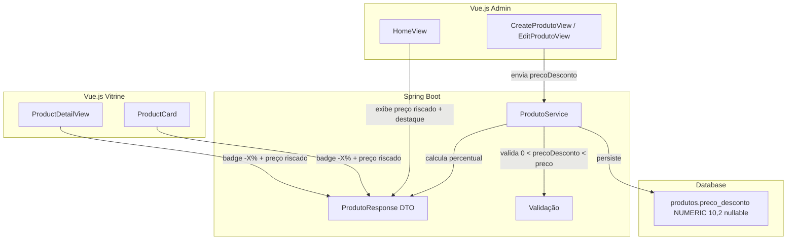
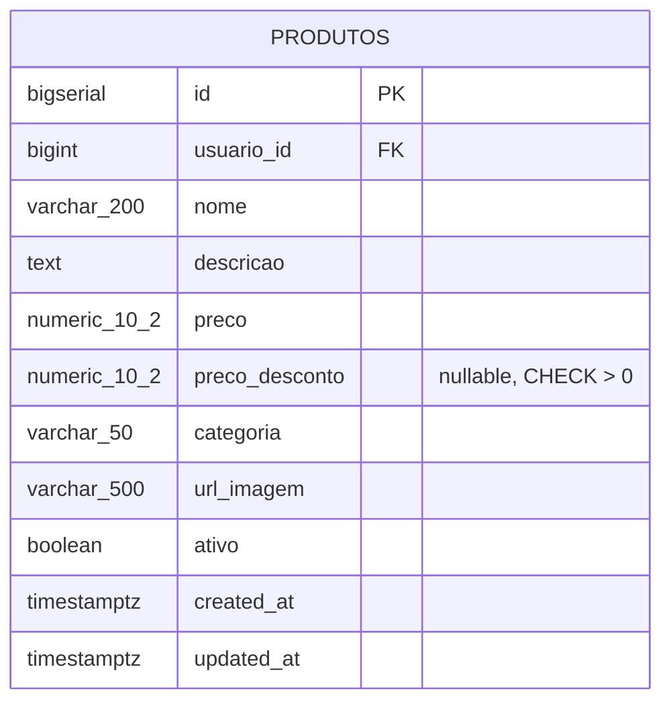
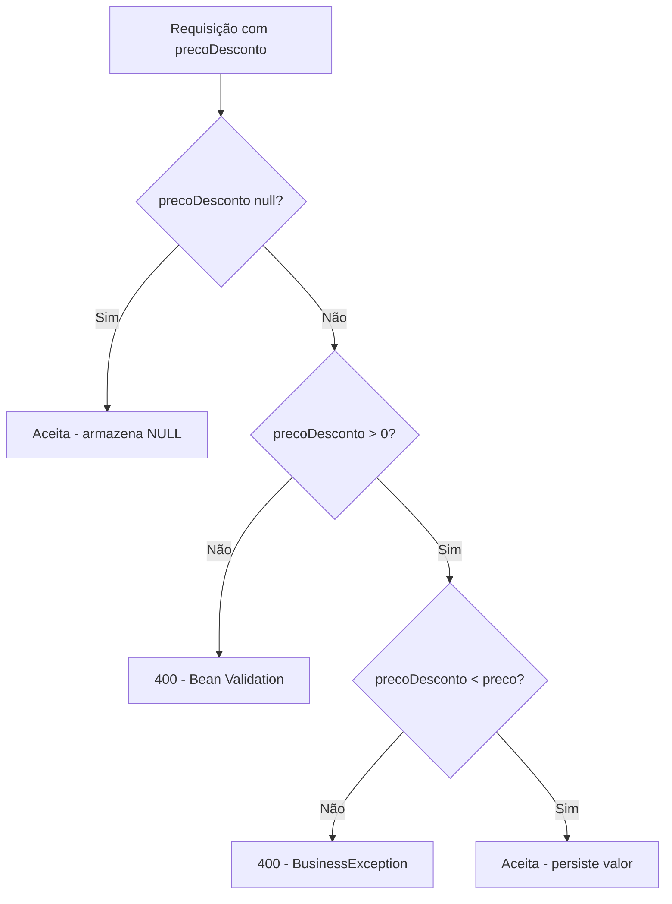

# Design Técnico — Preço com Desconto

## Overview

Esta feature adiciona suporte a preço com desconto na plataforma Place Offers. O fluxo envolve:
1. Uma migration Flyway adiciona a coluna `preco_desconto` (NUMERIC(10,2), nullable) à tabela `produtos`
2. O back-end valida, persiste e calcula o `percentualDesconto` de forma computada (não armazenado)
3. Os front-ends (admin e vitrine) exibem preço original riscado, preço com desconto em destaque e badge "-X%"

A abordagem de campo computado evita inconsistência entre o percentual e os valores reais, mantendo a fonte da verdade no par (preco, precoDesconto).

## Architecture



### Decisões Arquiteturais

| Decisão | Justificativa |
|---------|---------------|
| `percentualDesconto` computado no back-end | Evita inconsistência; uma única fonte de verdade para o cálculo |
| Coluna nullable | NULL = sem desconto; simplifica queries e lógica condicional |
| CHECK constraint no banco | Defesa em profundidade: garante integridade mesmo sem passar pela aplicação |
| Arredondamento para inteiro | Percentuais fracionários não fazem sentido na UI ("-33.33%" é confuso) |

## Components and Interfaces

### Camada de Banco de Dados

**Migration V3** — `V3__add_preco_desconto_to_produtos.sql`:

```sql
ALTER TABLE produtos
    ADD COLUMN preco_desconto NUMERIC(10,2),
    ADD CONSTRAINT ck_produtos_preco_desconto_positive CHECK (preco_desconto > 0);
```

### Camada Back-end (Java / Spring Boot)

**Entidade `Produto`** — novo campo:

```java
@Column(name = "preco_desconto", precision = 10, scale = 2)
private BigDecimal precoDesconto;
```

**DTO `ProdutoResponse`** — novos campos:

```java
public record ProdutoResponse(
    // ... campos existentes
    BigDecimal precoDesconto,
    Integer percentualDesconto
) {}
```

**DTO `CreateProdutoRequest`** — novo campo opcional:

```java
@DecimalMin(value = "0.01", message = "Preço com desconto deve ser maior que zero")
BigDecimal precoDesconto
```

**DTO `UpdateProdutoRequest`** — novo campo opcional:

```java
@DecimalMin(value = "0.01", message = "Preço com desconto deve ser maior que zero")
BigDecimal precoDesconto
```

**`ProdutoService.toResponse`** — lógica de cálculo:

```java
private Integer calcularPercentualDesconto(BigDecimal preco, BigDecimal precoDesconto) {
    if (precoDesconto == null) return null;
    BigDecimal diferenca = preco.subtract(precoDesconto);
    BigDecimal percentual = diferenca.divide(preco, 4, RoundingMode.HALF_UP)
                                     .multiply(BigDecimal.valueOf(100));
    return percentual.setScale(0, RoundingMode.HALF_UP).intValue();
}
```

**Validação no `ProdutoService`** (create/update):

```java
private void validarPrecoDesconto(BigDecimal preco, BigDecimal precoDesconto) {
    if (precoDesconto != null && precoDesconto.compareTo(preco) >= 0) {
        throw new BusinessException("Preço com desconto deve ser menor que o preço original");
    }
}
```

### Camada Front-end Admin

**Interface `Produto`** (produtoService.ts):

```typescript
export interface Produto {
  // ... campos existentes
  precoDesconto: number | null
  percentualDesconto: number | null
}
```

**Interface `CreateProdutoRequest`**:

```typescript
export interface CreateProdutoRequest {
  // ... campos existentes
  precoDesconto?: number | null
}
```

**Interface `UpdateProdutoRequest`**:

```typescript
export interface UpdateProdutoRequest {
  // ... campos existentes
  precoDesconto?: number | null
}
```

**HomeView** — exibição condicional na listagem:
- Se `precoDesconto` preenchido: preço original com `text-decoration: line-through`, preço com desconto em destaque
- Se `precoDesconto` null: exibição normal do preço

**CreateProdutoView / EditProdutoView** — campo opcional com validação client-side:
- Input numérico "Preço com desconto" (opcional)
- Validação: se preenchido, deve ser menor que o preço original
- Se vazio, envia `null`

### Camada Front-end Vitrine

**Interface `Produto`** (types/produto.ts):

```typescript
export interface Produto {
  // ... campos existentes
  precoDesconto: number | null
  percentualDesconto: number | null
}
```

**ProductCard.vue** — exibição condicional:
- Se `precoDesconto` preenchido: preço original riscado + preço desconto em destaque + badge "-X%"
- Se `precoDesconto` null: apenas preço original

**ProductDetailView.vue** — mesma lógica do card, adaptada ao layout de detalhe.

## Data Models

### Schema do Banco (após migration)



### DTO de Resposta da API

| Campo | Tipo | Descrição |
|-------|------|-----------|
| `precoDesconto` | `BigDecimal \| null` | Preço com desconto (nullable) |
| `percentualDesconto` | `Integer \| null` | Percentual computado: `round((preco - precoDesconto) / preco * 100)`. Valor entre 1 e 99. |

### Contrato JSON (exemplo)

```json
{
  "id": 1,
  "nome": "Camiseta Polo",
  "preco": 89.90,
  "precoDesconto": 59.90,
  "percentualDesconto": 33,
  "categoria": "VESTUARIO",
  "ativo": true
}
```

Produto sem desconto:
```json
{
  "id": 2,
  "nome": "Fone Bluetooth",
  "preco": 199.90,
  "precoDesconto": null,
  "percentualDesconto": null,
  "categoria": "ELETRODOMESTICOS",
  "ativo": true
}
```

## Correctness Properties

*Uma propriedade é uma característica ou comportamento que deve ser verdadeiro em todas as execuções válidas de um sistema — essencialmente, uma declaração formal sobre o que o sistema deve fazer. Propriedades servem como a ponte entre especificações legíveis por humanos e garantias de corretude verificáveis por máquina.*

### Property 1: Validação de preço com desconto

*Para qualquer* par (preco, precoDesconto) onde preco > 0, o sistema SHALL aceitar o precoDesconto se e somente se 0 < precoDesconto < preco. Valores onde precoDesconto <= 0 ou precoDesconto >= preco devem ser rejeitados.

**Validates: Requirements 1.2, 1.3**

### Property 2: Cálculo do percentual de desconto

*Para qualquer* par válido (preco, precoDesconto) onde 0 < precoDesconto < preco, o percentualDesconto computado SHALL ser igual a `round((preco - precoDesconto) / preco * 100)` e o resultado SHALL estar no intervalo [1, 99] inclusive.

**Validates: Requirements 2.1, 2.4**

### Property 3: Validação front-end do preço com desconto

*Para qualquer* par (preco, precoDesconto) no formulário do admin, a validação client-side SHALL rejeitar o envio se e somente se precoDesconto >= preco (quando o campo está preenchido).

**Validates: Requirements 3.2**

## Error Handling

| Cenário | Camada | Resposta |
|---------|--------|----------|
| `precoDesconto <= 0` | Banco (CHECK) + Bean Validation | 400 Bad Request com mensagem de campo |
| `precoDesconto >= preco` | Service (BusinessException) | 400 Bad Request: "Preço com desconto deve ser menor que o preço original" |
| `precoDesconto` com formato inválido | Jackson deserialização | 400 Bad Request: erro de parsing |
| Campo vazio no formulário admin | Front-end | Envia `null` (sem erro — campo é opcional) |
| Validação front-end falha (desconto >= preço) | Front-end | Exibe mensagem inline antes de enviar |

### Fluxo de Validação



## Testing Strategy

### Testes Unitários (Back-end)

- **ProdutoService**: validação de precoDesconto < preco, cálculo do percentual, cenário null
- **ProdutoResponse**: verificar que campos precoDesconto e percentualDesconto estão presentes
- **Validação Bean**: testar @DecimalMin no DTO

### Testes de Propriedade (Back-end — JUnit 5 + jqwik)

A feature possui lógica de validação e cálculo puro que é ideal para PBT:

- **Property 1**: Gerar pares aleatórios (preco, precoDesconto) e validar aceitação/rejeição
- **Property 2**: Gerar pares válidos e verificar fórmula + range [1,99]

Configuração:
- Mínimo 100 iterações por propriedade
- Biblioteca: **jqwik** (property-based testing para JUnit 5)
- Tag: `Feature: discount-price, Property {N}: {texto}`

### Testes Unitários (Front-end)

- **Vitest + @vue/test-utils** para componentes Vue
- ProductCard: renderização com/sem desconto, badge format
- ProductDetailView: renderização com/sem desconto
- HomeView: preço riscado vs normal na listagem
- Formulários: validação client-side, envio de null quando vazio

### Testes de Propriedade (Front-end — Vitest + fast-check)

- **Property 3**: Gerar pares (preco, precoDesconto) e validar função de validação do formulário

Configuração:
- Mínimo 100 iterações
- Biblioteca: **fast-check**
- Tag: `Feature: discount-price, Property 3: Validação front-end do preço com desconto`

### Testes de Integração

- API POST /produtos com precoDesconto válido → 201 com percentual calculado
- API POST /produtos com precoDesconto >= preco → 400
- API GET /produtos/{id} → resposta com precoDesconto e percentualDesconto
- Migration V3 aplica sem erros

### Testes Smoke

- Verificar que a coluna `preco_desconto` existe após migration
- Verificar que CHECK constraint `ck_produtos_preco_desconto_positive` existe
- Compilação TypeScript passa com os novos campos nas interfaces
