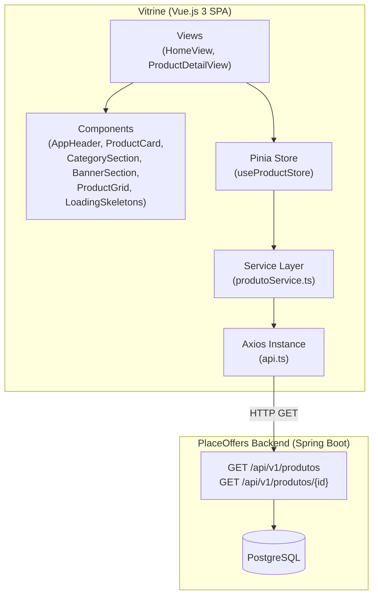
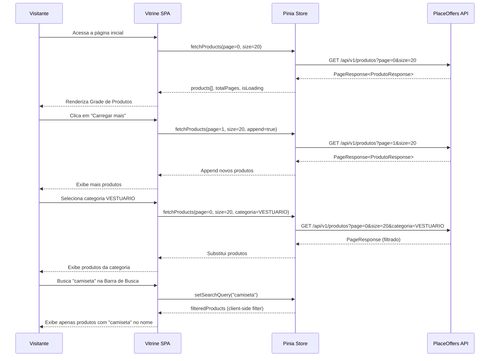
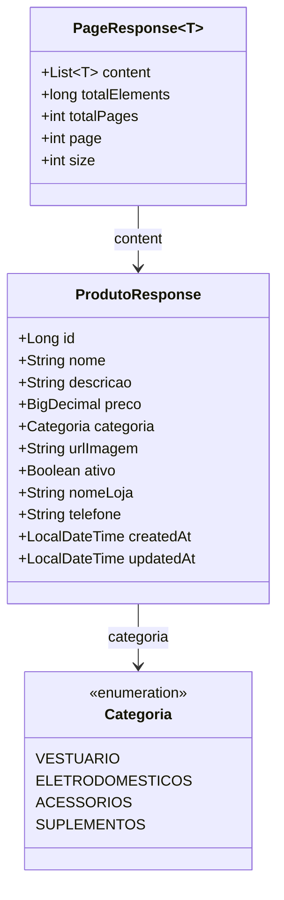
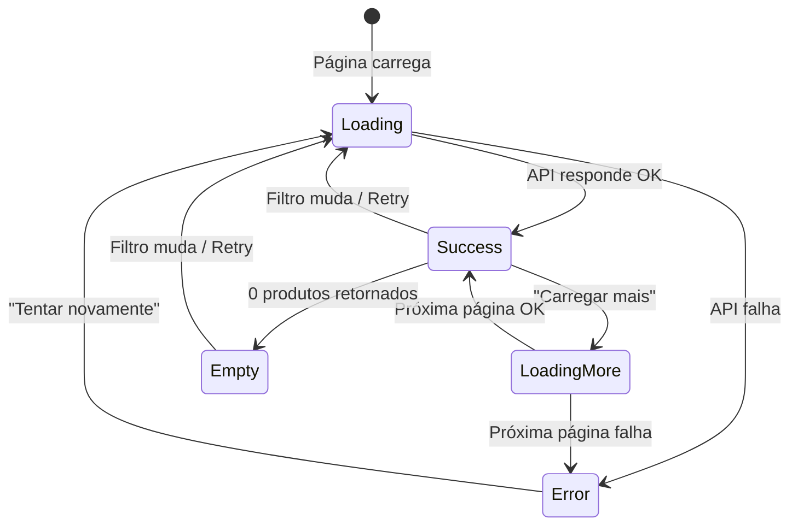

# Design Document: Marketplace Vitrine

## Overview

O Marketplace Vitrine é uma aplicação Vue.js 3 pública e somente leitura, completamente desacoplada do projeto PlaceOffers existente. Ela consome a API REST do backend (`/api/v1/produtos`) para exibir produtos ativos a visitantes não autenticados.

A aplicação será construída como um projeto standalone em seu próprio diretório raiz (`vitrine/`), com stack Vue.js 3 + TypeScript + Vite + Pinia + Vue Router + Axios. O design prioriza performance de carregamento, responsividade, acessibilidade (WCAG AA) e resiliência a falhas de rede.

### Decisões Arquiteturais Principais

| Decisão | Escolha | Justificativa |
|---------|---------|---------------|
| Projeto separado | Diretório `vitrine/` na raiz do workspace | Independência total de build/deploy, sem compartilhamento de node_modules |
| Gerenciamento de estado | Pinia (setup syntax) | Consistência com o padrão do workspace, leve e type-safe |
| HTTP Client | Axios (sem interceptors de auth) | Somente GET, sem tokens — instância limpa e simples |
| Roteamento | Vue Router 4 (history mode) | SPA com navegação entre home e detalhe do produto |
| Busca/Filtro | Client-side sobre dados carregados + paginação da API | Busca por nome é local; filtro por categoria usa query param da API |
| Estilização | CSS puro (scoped) | Sem dependência extra de UI framework, mantendo a vitrine leve |
| Paginação | "Carregar mais" (append) | UX de scroll contínuo, sem recarregar a página |

## Architecture



### Fluxo de Dados



## Components and Interfaces

### Estrutura de Diretórios da Vitrine

```
vitrine/
├── index.html
├── package.json
├── vite.config.ts
├── tsconfig.json
├── tsconfig.node.json
├── .env.development
├── .env.production
└── src/
    ├── App.vue
    ├── main.ts
    ├── assets/
    │   └── main.css
    ├── components/
    │   ├── layout/
    │   │   └── AppHeader.vue
    │   ├── product/
    │   │   ├── ProductCard.vue
    │   │   ├── ProductGrid.vue
    │   │   └── LoadingSkeletons.vue
    │   ├── home/
    │   │   ├── BannerSection.vue
    │   │   └── CategorySection.vue
    │   └── ui/
    │       ├── ErrorState.vue
    │       └── EmptyState.vue
    ├── composables/
    │   └── useFormatters.ts
    ├── router/
    │   └── index.ts
    ├── services/
    │   ├── api.ts
    │   └── produtoService.ts
    ├── stores/
    │   └── useProductStore.ts
    ├── types/
    │   ├── produto.ts
    │   └── api.ts
    └── views/
        ├── HomeView.vue
        └── ProductDetailView.vue
```

### Componentes Principais

#### AppHeader.vue
- Logo "PLACE OFFERS" à esquerda
- Barra de busca centralizada com input + botão de busca
- Position: fixed (sticky top)
- Emite evento `search` com o termo digitado

#### BannerSection.vue
- Props: `title: string` (max 60 caracteres)
- Renderiza título promocional com truncamento + ellipsis
- Background diferenciado do restante da página

#### CategorySection.vue
- Exibe 4 ícones de categoria (VESTUARIO, ELETRODOMESTICOS, ACESSORIOS, SUPLEMENTOS)
- Props: `activeCategory: string | null`
- Emite `select` com a categoria clicada
- Toggle: clicar na categoria ativa remove o filtro

#### ProductGrid.vue
- Props: `products: Produto[]`, `isLoading: boolean`
- Grid responsivo: 3 cols (desktop), 2 cols (tablet), 1 col (mobile)
- Renderiza ProductCard para cada produto

#### ProductCard.vue
- Props: `product: Produto`
- Exibe: imagem (200x200), nome (max 2 linhas), nomeLoja, preço (BRL), botão "Ver Oferta"
- Emite `view-detail` com o id do produto
- Placeholder cinza quando imagem é null ou falha ao carregar

#### LoadingSkeletons.vue
- Props: `count: number` (default 6)
- Renderiza `count` skeleton cards animados

#### ErrorState.vue
- Props: `message: string`
- Emite `retry`
- Botão "Tentar novamente"

#### EmptyState.vue
- Props: `message: string`
- Exibe mensagem de estado vazio

### Interfaces TypeScript

```typescript
// types/produto.ts
export interface Produto {
  id: number
  nome: string
  descricao: string | null
  preco: number
  categoria: Categoria
  urlImagem: string | null
  ativo: boolean
  nomeLoja: string | null
  telefone: string | null
  createdAt: string
  updatedAt: string
}

export type Categoria = 'VESTUARIO' | 'ELETRODOMESTICOS' | 'ACESSORIOS' | 'SUPLEMENTOS'

// types/api.ts
export interface PageResponse<T> {
  content: T[]
  totalElements: number
  totalPages: number
  page: number
  size: number
}
```

### Service Layer

```typescript
// services/api.ts
import axios from 'axios'

const api = axios.create({
  baseURL: import.meta.env.VITE_API_BASE_URL || 'http://localhost:8080/api/v1',
  headers: { 'Content-Type': 'application/json' },
  timeout: 10000,
})

export default api
```

```typescript
// services/produtoService.ts
import api from './api'
import type { Produto } from '@/types/produto'
import type { PageResponse } from '@/types/api'

export const produtoService = {
  async findAll(page = 0, size = 20, categoria?: string): Promise<PageResponse<Produto>> {
    const params: Record<string, unknown> = { page, size }
    if (categoria) params.categoria = categoria
    const { data } = await api.get('/produtos', { params })
    return data
  },

  async findById(id: number): Promise<Produto> {
    const { data } = await api.get(`/produtos/${id}`)
    return data
  },
}
```

### Pinia Store

```typescript
// stores/useProductStore.ts
import { defineStore } from 'pinia'
import { ref, computed } from 'vue'
import { produtoService } from '@/services/produtoService'
import type { Produto } from '@/types/produto'

export const useProductStore = defineStore('product', () => {
  const products = ref<Produto[]>([])
  const currentProduct = ref<Produto | null>(null)
  const isLoading = ref(false)
  const isLoadingMore = ref(false)
  const error = ref<string | null>(null)
  const currentPage = ref(0)
  const totalPages = ref(0)
  const searchQuery = ref('')
  const activeCategory = ref<string | null>(null)

  const filteredProducts = computed(() => {
    if (!searchQuery.value.trim()) return products.value
    const query = searchQuery.value.toLowerCase()
    return products.value.filter(p => p.nome.toLowerCase().includes(query))
  })

  const hasMorePages = computed(() => currentPage.value < totalPages.value - 1)

  async function fetchProducts(options?: { append?: boolean }) {
    const append = options?.append ?? false
    if (append) {
      isLoadingMore.value = true
    } else {
      isLoading.value = true
      currentPage.value = 0
    }
    error.value = null

    try {
      const page = append ? currentPage.value + 1 : 0
      const response = await produtoService.findAll(
        page, 20, activeCategory.value ?? undefined
      )
      const activeProducts = response.content.filter(p => p.ativo)
      if (append) {
        products.value = [...products.value, ...activeProducts]
        currentPage.value = page
      } else {
        products.value = activeProducts
        currentPage.value = response.page
      }
      totalPages.value = response.totalPages
    } catch {
      error.value = 'Não foi possível carregar os produtos. Tente novamente mais tarde.'
    } finally {
      isLoading.value = false
      isLoadingMore.value = false
    }
  }

  async function fetchProductById(id: number) {
    isLoading.value = true
    error.value = null
    currentProduct.value = null
    try {
      currentProduct.value = await produtoService.findById(id)
    } catch {
      error.value = 'Não foi possível carregar o produto.'
    } finally {
      isLoading.value = false
    }
  }

  function setSearchQuery(query: string) {
    searchQuery.value = query
  }

  function setCategory(categoria: string | null) {
    activeCategory.value = categoria
  }

  return {
    products, currentProduct, isLoading, isLoadingMore,
    error, currentPage, totalPages, searchQuery, activeCategory,
    filteredProducts, hasMorePages,
    fetchProducts, fetchProductById, setSearchQuery, setCategory,
  }
})
```

### Router

```typescript
// router/index.ts
import { createRouter, createWebHistory } from 'vue-router'

const router = createRouter({
  history: createWebHistory(import.meta.env.BASE_URL),
  routes: [
    {
      path: '/',
      name: 'home',
      component: () => import('@/views/HomeView.vue'),
    },
    {
      path: '/produto/:id',
      name: 'product-detail',
      component: () => import('@/views/ProductDetailView.vue'),
      props: true,
    },
  ],
})

export default router
```

## Data Models

### Modelo de Resposta da API (consumido pela Vitrine)

A Vitrine consome exclusivamente os endpoints GET da API existente. O contrato de dados já está definido pelo backend:



### Endpoints Consumidos pela Vitrine

| Método | Endpoint | Parâmetros | Uso na Vitrine |
|--------|----------|------------|----------------|
| GET | `/api/v1/produtos` | `page`, `size`, `categoria` | Listagem paginada, filtro por categoria |
| GET | `/api/v1/produtos/{id}` | - | Detalhe do produto |

**Importante**: A Vitrine NÃO envia `usuarioId` na listagem. Sem esse parâmetro, a API retorna apenas produtos ativos (`findByAtivoTrue`), que é exatamente o comportamento desejado.

### Estado Local (Pinia Store)

| Campo | Tipo | Descrição |
|-------|------|-----------|
| `products` | `Produto[]` | Lista acumulada de produtos carregados |
| `currentProduct` | `Produto \| null` | Produto da página de detalhe |
| `isLoading` | `boolean` | Carregamento inicial em progresso |
| `isLoadingMore` | `boolean` | "Carregar mais" em progresso |
| `error` | `string \| null` | Mensagem de erro (null = sem erro) |
| `currentPage` | `number` | Página atual da paginação |
| `totalPages` | `number` | Total de páginas disponível |
| `searchQuery` | `string` | Termo de busca atual |
| `activeCategory` | `string \| null` | Categoria filtrada (null = todas) |

### Formatação de Dados

| Campo | Transformação |
|-------|---------------|
| `preco` | `Intl.NumberFormat('pt-BR', { style: 'currency', currency: 'BRL' })` → "R$ 1.299,90" |
| `nome` no Card | Truncar com CSS `line-clamp: 2` + ellipsis |
| Banner title | Truncar a 60 caracteres com ellipsis se necessário |
| `urlImagem` | Se null ou erro no load → placeholder cinza 200×200 |

## Correctness Properties

*A property is a characteristic or behavior that should hold true across all valid executions of a system — essentially, a formal statement about what the system should do. Properties serve as the bridge between human-readable specifications and machine-verifiable correctness guarantees.*

### Property 1: Search filter correctness

*For any* list of products and *for any* non-empty search string, the filtered results shall contain only products whose `nome` includes the search string using case-insensitive comparison, and every product in the original list whose `nome` contains the search string (case-insensitive) shall appear in the filtered results.

**Validates: Requirements 2.3, 2.5**

### Property 2: Banner title truncation

*For any* string input as promotional title, the displayed output shall satisfy: if the input length is ≤ 60 characters, the output equals the input unchanged; if the input length exceeds 60 characters, the output equals the first 60 characters of the input followed by the ellipsis character ("…"), resulting in exactly 61 characters total.

**Validates: Requirements 3.2, 3.4**

### Property 3: Active product filtering

*For any* API response containing a list of products with mixed `ativo` values (true/false), the store shall expose only products where `ativo === true`, and the count of displayed products shall equal the count of products with `ativo === true` in the original response.

**Validates: Requirements 5.3**

### Property 4: Price formatting as BRL currency

*For any* non-negative number representing a price, the formatted output shall start with "R$", use a comma as the decimal separator with exactly 2 decimal places, and use a period as the thousands separator. The numeric value parsed back from the formatted string (reversing the locale format) shall equal the original value rounded to 2 decimal places.

**Validates: Requirements 6.4**

### Property 5: Pagination appends without data loss

*For any* current product list and *for any* new page of products fetched via "Carregar mais", the resulting list shall contain all previously loaded products in their original order followed by the new products appended at the end, and the total length shall equal the sum of the previous list length plus the new page length.

**Validates: Requirements 8.2**

### Property 6: hasMorePages correctness

*For any* `currentPage` (integer ≥ 0) and `totalPages` (integer ≥ 1), the `hasMorePages` computed value shall be `true` if and only if `currentPage < totalPages - 1`.

**Validates: Requirements 8.3, 8.4**

### Property 7: Product image alt text

*For any* product with a non-null `nome`, the rendered product card image shall have an `alt` attribute whose value equals the product's `nome`.

**Validates: Requirements 11.3**

## Error Handling

### Estratégia de Tratamento de Erros

A Vitrine adota uma abordagem defensiva para lidar com falhas de rede e respostas inesperadas da API:

| Cenário | Comportamento | Componente Responsável |
|---------|---------------|------------------------|
| API indisponível (network error) | Exibe mensagem amigável + botão "Tentar novamente" | ErrorState.vue |
| API retorna 4xx/5xx | Exibe mensagem genérica + botão retry | ErrorState.vue |
| API retorna lista vazia | Exibe "Nenhum produto encontrado" | EmptyState.vue |
| Filtro de busca sem resultados | Exibe mensagem + mantém controles visíveis | EmptyState.vue |
| Imagem do produto falha ao carregar | Exibe placeholder cinza 200×200 | ProductCard.vue (evento `@error`) |
| Produto individual não encontrado (404) | Exibe erro + botão voltar para home | ProductDetailView.vue |
| Timeout na requisição (10s) | Trata como erro de rede | Axios config |

### Princípios de Erro

1. **Nunca expor detalhes técnicos**: mensagens de erro são sempre em linguagem natural para o visitante
2. **Sempre oferecer ação de recuperação**: botão "Tentar novamente" ou "Voltar para início"
3. **Nunca tela em branco**: todos os estados (loading, error, empty) têm representação visual
4. **Preservar contexto**: ao dar retry, manter filtros e busca ativos
5. **Degradação graciosa**: se uma imagem falha, o card continua funcional com placeholder

### Fluxo de Estados



## Testing Strategy

### Abordagem de Testes

A estratégia de testes combina testes unitários (exemplos específicos), testes de propriedade (cobertura ampla) e testes E2E (fluxos de usuário):

| Tipo | Ferramenta | Foco |
|------|-----------|------|
| Unitário | Vitest + @vue/test-utils | Componentes, composables, formatadores |
| Propriedade (PBT) | Vitest + fast-check | Lógica pura: filtro, formatação, truncamento, paginação |
| E2E | Playwright | Fluxos completos de navegação |

### Testes de Propriedade (PBT)

Biblioteca: **fast-check** (via `@fast-check/vitest` ou integração direta com Vitest)

Configuração: mínimo **100 iterações** por propriedade.

Cada teste de propriedade referencia o design property correspondente:

```typescript
// Formato de tag:
// Feature: marketplace-vitrine, Property {N}: {título}
```

**Propriedades a implementar:**

1. **Search filter correctness** — Gerar listas aleatórias de produtos e termos de busca, verificar invariantes de inclusão/exclusão
2. **Banner title truncation** — Gerar strings de comprimento variado, verificar comportamento de truncamento
3. **Active product filtering** — Gerar listas com mix de ativo/inativo, verificar filtragem
4. **Price formatting as BRL** — Gerar números positivos, verificar formato de saída
5. **Pagination appends without data loss** — Gerar sequências de páginas, verificar invariante de append
6. **hasMorePages correctness** — Gerar pares (currentPage, totalPages), verificar computed
7. **Product image alt text** — Gerar produtos com nomes aleatórios, verificar atributo alt

### Testes Unitários (Exemplos)

Foco em cenários específicos e edge cases:

- **Components**: renderização condicional, eventos emitidos, props handling
- **Store**: state mutations, ações async com mocks de API
- **Service**: construção correta de URLs e parâmetros
- **Router**: rotas definidas corretamente, sem rotas de mutação
- **Acessibilidade**: elementos semânticos, aria-labels, tab order

### Testes E2E (Playwright)

- Navegação home → detalhe → home
- Busca por produto com resultados
- Busca sem resultados (estado vazio)
- Filtro por categoria
- "Carregar mais" produtos
- Erro de rede com retry
- Responsividade em viewports mobile/tablet/desktop

### Configuração do Projeto de Testes

```json
{
  "devDependencies": {
    "vitest": "^1.6.0",
    "@vue/test-utils": "^2.4.0",
    "fast-check": "^3.19.0",
    "@vitejs/plugin-vue": "^5.0.4",
    "jsdom": "^24.0.0"
  }
}
```

Vitest config com suporte a fast-check:

```typescript
// vitest.config.ts
import { defineConfig } from 'vitest/config'
import vue from '@vitejs/plugin-vue'
import { resolve } from 'path'

export default defineConfig({
  plugins: [vue()],
  resolve: { alias: { '@': resolve(__dirname, 'src') } },
  test: {
    environment: 'jsdom',
    globals: true,
  },
})
```

