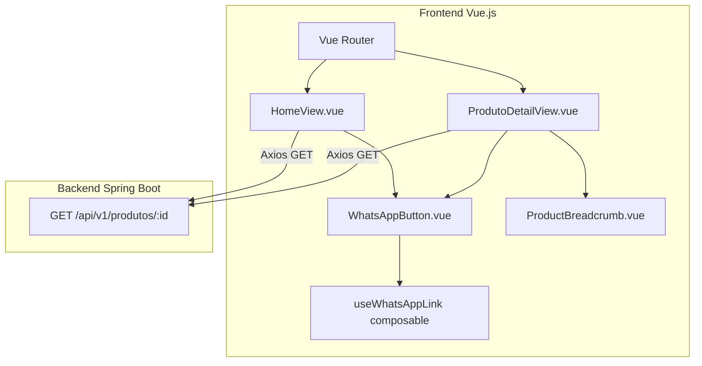
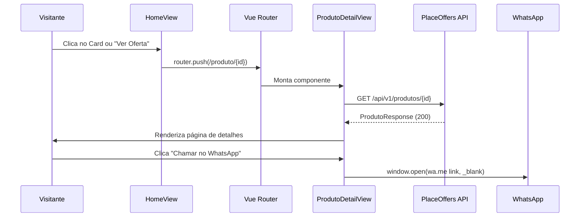

# Design Document: Product Detail Page with WhatsApp Contact

## Overview

Esta feature implementa a Página de Detalhes do Produto (estilo Mercado Livre) e o Botão de Contato via WhatsApp no projeto PlaceOffers. A funcionalidade é 100% frontend — não requer alterações no backend, pois o endpoint `GET /api/v1/produtos/{id}` já existe e retorna todos os campos necessários (`nome`, `descricao`, `preco`, `categoria`, `urlImagem`, `nomeLoja`, `telefone`).

A implementação envolve:
1. Uma nova view `ProdutoDetailView.vue` com layout responsivo two-column (estilo Mercado Livre)
2. Um composable `useWhatsAppLink.ts` com a lógica de formatação do link WhatsApp
3. Um componente reutilizável `WhatsAppButton.vue` usado tanto na página de detalhes quanto no Card de Produto da homepage
4. Atualização do router para incluir a rota `/produto/:id`
5. Atualização do `HomeView.vue` para adicionar o botão WhatsApp nos cards e transformar os cards em links clicáveis

### Decisões de Design

- **Sem alteração no backend**: O endpoint `GET /api/v1/produtos/{id}` já retorna `ProdutoResponse` com os campos `nomeLoja` e `telefone` derivados do `Usuario` via `@Transient`.
- **Composable para lógica WhatsApp**: A formatação do número de telefone é uma lógica pura com regras complexas (strip, prefixo 55, validação de dígitos). Encapsular num composable garante reutilização e testabilidade.
- **Componente WhatsApp reutilizável**: O `WhatsAppButton.vue` aceita `telefone` e `nomeProduto` como props e encapsula toda a lógica de visibilidade e geração de link.
- **CSS puro com scoped styles**: Seguindo o padrão existente do projeto (sem Tailwind CSS), os estilos são escritos em CSS puro com scoped.

## Architecture



### Fluxo de Navegação



## Components and Interfaces

### Novos Componentes

| Componente | Localização | Responsabilidade |
|---|---|---|
| `ProdutoDetailView.vue` | `src/views/ProdutoDetailView.vue` | Página de detalhes com layout two-column |
| `WhatsAppButton.vue` | `src/components/ui/WhatsAppButton.vue` | Botão reutilizável de contato WhatsApp |
| `ProductBreadcrumb.vue` | `src/components/ui/ProductBreadcrumb.vue` | Breadcrumb de navegação |

### Novo Composable

| Composable | Localização | Responsabilidade |
|---|---|---|
| `useWhatsAppLink.ts` | `src/composables/useWhatsAppLink.ts` | Formatação de telefone e geração de link WhatsApp |

### Interfaces TypeScript

```typescript
// src/composables/useWhatsAppLink.ts

export interface WhatsAppLinkResult {
  /** URL completa do WhatsApp (null se telefone inválido) */
  whatsappUrl: string | null
  /** Se o telefone é válido para gerar link */
  isValid: boolean
}

export function useWhatsAppLink(telefone: string | null | undefined, nomeProduto: string | null | undefined): WhatsAppLinkResult
```

```typescript
// WhatsAppButton.vue Props
interface WhatsAppButtonProps {
  telefone: string | null
  nomeProduto: string | null
  nomeLoja?: string | null
  /** Variante visual: 'full' (detalhes) ou 'compact' (card) */
  variant?: 'full' | 'compact'
}
```

```typescript
// ProductBreadcrumb.vue Props
interface ProductBreadcrumbProps {
  categoria: string | null
  nomeProduto: string
}
```

### Componentes Modificados

| Componente | Modificação |
|---|---|
| `HomeView.vue` | Adicionar `WhatsAppButton` nos cards, tornar cards clicáveis para `/produto/{id}` |
| `router/index.ts` | Adicionar rota `/produto/:id` |

### API Existente Utilizada

```
GET /api/v1/produtos/{id}
Response: ProdutoResponse {
  id: number
  nome: string
  descricao: string | null
  preco: BigDecimal
  categoria: "VESTUARIO" | "ELETRODOMESTICOS" | "ACESSORIOS" | "SUPLEMENTOS" | null
  urlImagem: string | null
  ativo: boolean
  nomeLoja: string | null
  telefone: string | null
  createdAt: string
  updatedAt: string
}
```

## Data Models

### Modelo de Dados Frontend (já existente)

A interface `Produto` em `src/services/produtoService.ts` já contempla todos os campos necessários:

```typescript
export interface Produto {
  id: number
  nome: string
  descricao: string | null
  preco: number
  categoria: string       // Enum como string: VESTUARIO, ELETRODOMESTICOS, etc.
  urlImagem: string | null
  ativo: boolean
  nomeLoja: string | null
  telefone: string | null
  createdAt: string
  updatedAt: string
}
```

### Modelo de Dados Backend (já existente)

A entidade `Produto` possui campos `@Transient` (`getNomeLoja()`, `getTelefone()`) que delegam para o `Usuario` associado. O `ProdutoResponse` record já serializa esses campos para a API.

### Regras de Formatação do Telefone

A lógica do composable `useWhatsAppLink` segue estas transformações:

| Input (telefone) | Após strip | Após normalização | Resultado |
|---|---|---|---|
| `"(11) 99999-8888"` | `"11999998888"` | `"5511999998888"` | Válido (13 dígitos) |
| `"+55 11 99999-8888"` | `"5511999998888"` | `"5511999998888"` | Válido (já tem 55) |
| `"011999998888"` | `"011999998888"` | `"5511999998888"` | Válido (remove 0, add 55) |
| `"999998888"` | `"999998888"` | Inválido | < 10 dígitos |
| `""` | `""` | Inválido | Vazio |
| `null` | — | Inválido | Null |

### Estrutura de Estado da Página de Detalhes

```typescript
interface ProdutoDetailState {
  produto: Produto | null
  isLoading: boolean
  error: 'not-found' | 'server-error' | null
}
```


## Correctness Properties

*A property is a characteristic or behavior that should hold true across all valid executions of a system — essentially, a formal statement about what the system should do. Properties serve as the bridge between human-readable specifications and machine-verifiable correctness guarantees.*

### Property 1: Phone number formatting produces valid international format

*For any* phone string that, after stripping all non-numeric characters and removing a leading "0", contains between 10 and 11 digits (or already starts with "55" followed by 10-11 digits giving 12-13 total), the `formatWhatsAppNumber` function SHALL return a digit-only string of exactly 12 or 13 characters that starts with "55".

**Validates: Requirements 3.2, 5.1, 5.2, 5.3, 5.4, 5.5**

### Property 2: Invalid phone numbers are rejected

*For any* string (including null, empty, whitespace-only, or strings whose digit count after stripping non-numeric characters and removing a leading "0" is fewer than 10 or greater than 11 — excluding a "55" prefix that would make total 12-13), the `formatWhatsAppNumber` function SHALL return null (invalid), and the WhatsApp button SHALL not be rendered.

**Validates: Requirements 3.4, 3.6, 4.4, 5.6**

### Property 3: Message text is correctly URL-encoded in WhatsApp link

*For any* product name string (including strings with special characters, accents, spaces, emojis, or null), the generated WhatsApp URL's `text` query parameter SHALL equal `encodeURIComponent("Olá! Tenho interesse no produto: " + nome)` where nome defaults to empty string when null.

**Validates: Requirements 5.7**

## Error Handling

### Estratégia de Tratamento de Erros

| Cenário | Resposta da UI | Ação Disponível |
|---|---|---|
| API retorna 404 | "Produto não encontrado" | Botão "Voltar para a página inicial" → navega para `/` |
| API retorna 5xx ou erro de rede | "Não foi possível carregar o produto" | Botão "Tentar novamente" → re-executa fetch |
| ID da rota não-numérico | Redirect silencioso | Navega automaticamente para `/` |
| Timeout (>30s) | Exibe erro de timeout | Botão "Tentar novamente" |
| Imagem falha ao carregar | Placeholder cinza | Nenhuma ação (graceful degradation) |
| Telefone inválido | Botão WhatsApp oculto | Nenhuma ação visível para o usuário |

### Implementação no ProdutoDetailView

```typescript
// Estado de erro
type ErrorState = 'not-found' | 'server-error' | null

// Navigation guard para ID não-numérico
router.beforeEach((to) => {
  if (to.name === 'produto-detail') {
    const id = to.params.id as string
    if (!/^\d+$/.test(id)) {
      return { name: 'home' }
    }
  }
})
```

### Retry Logic

O botão "Tentar novamente" simplesmente re-invoca a função `fetchProduto()`. Não há limite de retries — cada clique dispara uma nova requisição. O estado de loading é exibido durante cada tentativa.

## Testing Strategy

### Testes Unitários (Vitest + @vue/test-utils)

| Escopo | Quantidade Estimada | Foco |
|---|---|---|
| `useWhatsAppLink` composable | ~10 testes | Formatação de telefone, validação, URL encoding |
| `WhatsAppButton.vue` | ~6 testes | Renderização condicional, props, acessibilidade |
| `ProductBreadcrumb.vue` | ~4 testes | Renderização com/sem categoria, links |
| `ProdutoDetailView.vue` | ~8 testes | Loading, erro, dados, responsividade |
| `HomeView.vue` (modificações) | ~4 testes | WhatsApp no card, event propagation |

### Testes de Propriedade (Vitest + fast-check)

A biblioteca **fast-check** será utilizada para property-based testing no frontend TypeScript.

Cada property test deve:
- Rodar no mínimo **100 iterações**
- Referenciar a propriedade do design document via tag comment
- Testar a função pura `formatWhatsAppNumber` e `buildWhatsAppUrl` do composable

```typescript
// Exemplo de configuração
import fc from 'fast-check'
import { describe, it, expect } from 'vitest'

describe('useWhatsAppLink - Property Tests', () => {
  // Feature: product-detail-whatsapp, Property 1: Phone number formatting produces valid international format
  it('should produce valid 12-13 digit number starting with 55 for any valid input', () => {
    fc.assert(
      fc.property(
        // Gerar telefones válidos com 10-11 dígitos
        fc.stringOf(fc.constantFrom('0','1','2','3','4','5','6','7','8','9'), { minLength: 10, maxLength: 11 }),
        (digits) => {
          const result = formatWhatsAppNumber(digits)
          expect(result).not.toBeNull()
          expect(result!.length).toBeGreaterThanOrEqual(12)
          expect(result!.length).toBeLessThanOrEqual(13)
          expect(result!.startsWith('55')).toBe(true)
          expect(/^\d+$/.test(result!)).toBe(true)
        }
      ),
      { numRuns: 100 }
    )
  })
})
```

### Testes E2E (Playwright)

| Cenário | Prioridade |
|---|---|
| Navegação card → página de detalhes | Alta |
| Clique no WhatsApp abre nova aba | Alta |
| Layout responsivo (mobile/tablet/desktop) | Média |
| Acessibilidade (tab order, aria-labels) | Média |
| Erro 404 e retry | Média |

### Cobertura Esperada

- **Unit tests**: ≥ 90% do composable `useWhatsAppLink`
- **Component tests**: ≥ 80% dos novos componentes
- **Property tests**: 3 propriedades com 100+ iterações cada
- **E2E**: Fluxos críticos (navegação, WhatsApp click, erro)
