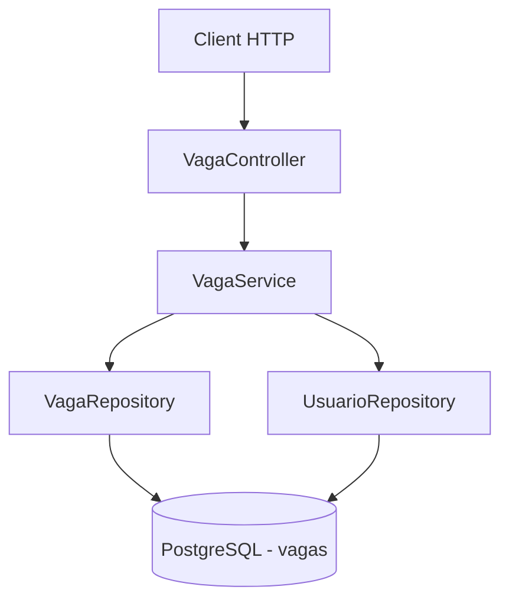
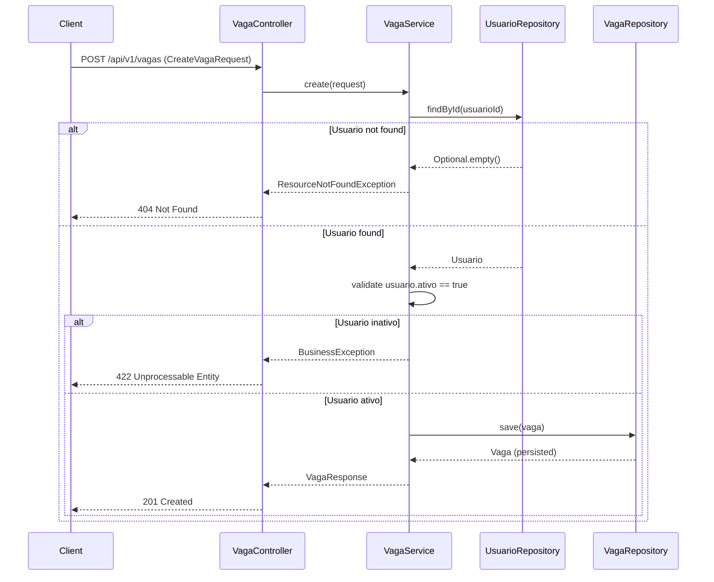
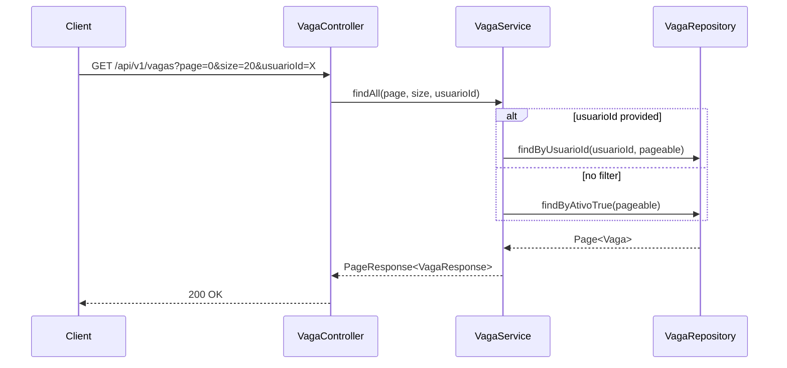
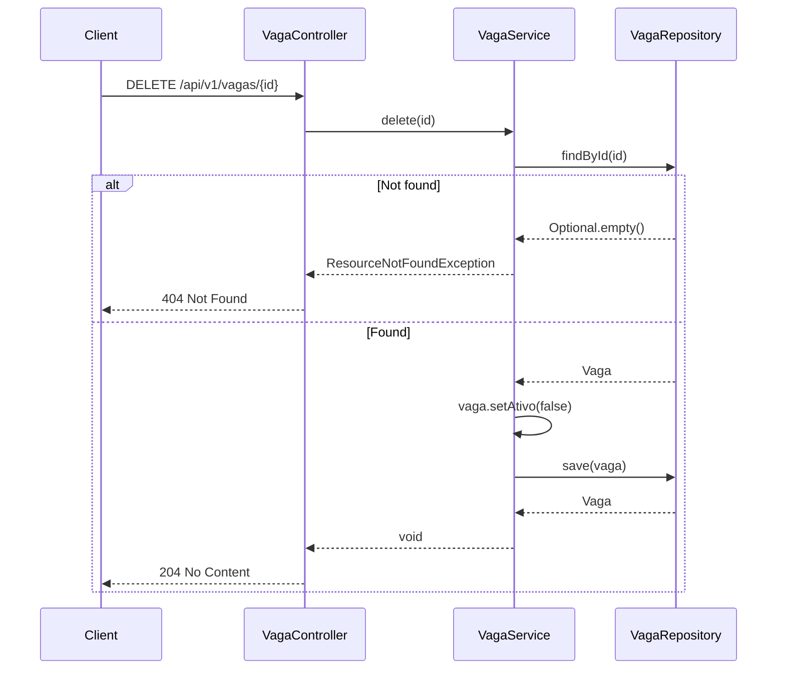

# Design Document: Vagas (Job Openings CRUD)

## Overview

Módulo de vagas de emprego para a plataforma Daqui. Permite que usuários cadastrados publiquem vagas de emprego vinculadas ao seu perfil, com operações completas de CRUD seguindo o padrão soft delete já estabelecido no projeto. O módulo segue a mesma arquitetura domain-package do módulo `produto`.

## Architecture



## Sequence Diagrams

### Create Vaga



### List Vagas (Paginated)



### Soft Delete



## Components and Interfaces

### Component 1: VagaController

**Purpose**: Expor os endpoints REST para operações CRUD de vagas.

**Interface**:
```java
@RestController
@RequestMapping("/api/v1/vagas")
@RequiredArgsConstructor
public class VagaController {
    ResponseEntity<VagaResponse> create(@Valid @RequestBody CreateVagaRequest request);
    ResponseEntity<PageResponse<VagaResponse>> findAll(int page, int size, Long usuarioId);
    ResponseEntity<VagaResponse> findById(@PathVariable Long id);
    ResponseEntity<VagaResponse> update(@PathVariable Long id, @Valid @RequestBody UpdateVagaRequest request);
    ResponseEntity<Void> delete(@PathVariable Long id);
}
```

**Responsibilities**:
- Validar payload de entrada via Bean Validation
- Delegar operações ao VagaService
- Retornar status HTTP adequados (201, 200, 204, 404, 422)

### Component 2: VagaService

**Purpose**: Implementar regras de negócio para vagas.

**Interface**:
```java
@Service
@RequiredArgsConstructor
@Transactional(readOnly = true)
public class VagaService {
    @Transactional VagaResponse create(CreateVagaRequest request);
    PageResponse<VagaResponse> findAll(int page, int size, Long usuarioId);
    VagaResponse findById(Long id);
    @Transactional VagaResponse update(Long id, UpdateVagaRequest request);
    @Transactional void delete(Long id);
}
```

**Responsibilities**:
- Validar existência do usuário ao criar vaga
- Validar que o usuário está ativo ao criar vaga
- Mapear entre entidades e DTOs (manual, sem MapStruct)
- Aplicar soft delete (ativo=false)
- Limitar tamanho máximo de página a 50

### Component 3: VagaRepository

**Purpose**: Acesso a dados da tabela vagas.

**Interface**:
```java
public interface VagaRepository extends JpaRepository<Vaga, Long> {
    Page<Vaga> findByAtivoTrue(Pageable pageable);
    Page<Vaga> findByUsuarioId(Long usuarioId, Pageable pageable);
    Page<Vaga> findByUsuarioIdAndAtivoTrue(Long usuarioId, Pageable pageable);
}
```

**Responsibilities**:
- Queries paginadas para listagem geral (apenas ativas)
- Queries paginadas por usuário (todas, para gerenciamento próprio)

## Data Models

### Entity: Vaga

```java
@Entity
@Table(name = "vagas")
@Getter @Setter @NoArgsConstructor
@EntityListeners(AuditingEntityListener.class)
public class Vaga {
    @Id
    @GeneratedValue(strategy = GenerationType.IDENTITY)
    private Long id;

    @ManyToOne(fetch = FetchType.LAZY)
    @JoinColumn(name = "usuario_id", nullable = false)
    private Usuario usuario;

    @Column(nullable = false, length = 200)
    private String cargo;

    @Column(columnDefinition = "TEXT")
    private String descricao;

    @Column(nullable = false)
    private Boolean ativo = true;

    @CreatedDate
    @Column(name = "created_at", nullable = false, updatable = false)
    private LocalDateTime createdAt;

    @LastModifiedDate
    @Column(name = "updated_at", nullable = false)
    private LocalDateTime updatedAt;
}
```

**Validation Rules**:
- `cargo`: obrigatório, máximo 200 caracteres
- `descricao`: opcional, sem limite prático (TEXT)
- `usuario_id`: obrigatório, deve referenciar um usuário existente e ativo
- `ativo`: default true, controlado pelo sistema (soft delete)

### DTO: CreateVagaRequest

```java
public record CreateVagaRequest(
    @NotNull(message = "ID do usuário é obrigatório")
    Long usuarioId,

    @NotBlank(message = "Cargo é obrigatório")
    @Size(max = 200, message = "Cargo deve ter no máximo 200 caracteres")
    String cargo,

    String descricao
) {}
```

### DTO: UpdateVagaRequest

```java
public record UpdateVagaRequest(
    @Size(max = 200, message = "Cargo deve ter no máximo 200 caracteres")
    String cargo,

    String descricao,

    Boolean ativo
) {}
```

### DTO: VagaResponse

```java
public record VagaResponse(
    Long id,
    Long usuarioId,
    String nomeUsuario,
    String nomeLoja,
    String cargo,
    String descricao,
    Boolean ativo,
    LocalDateTime createdAt,
    LocalDateTime updatedAt
) {}
```

### Migration: V4__create_vagas_table.sql

```sql
CREATE TABLE vagas (
    id          BIGSERIAL PRIMARY KEY,
    usuario_id  BIGINT NOT NULL,
    cargo       VARCHAR(200) NOT NULL,
    descricao   TEXT,
    ativo       BOOLEAN NOT NULL DEFAULT TRUE,
    created_at  TIMESTAMPTZ NOT NULL DEFAULT NOW(),
    updated_at  TIMESTAMPTZ NOT NULL DEFAULT NOW(),

    CONSTRAINT fk_vagas_usuario FOREIGN KEY (usuario_id)
        REFERENCES usuarios(id) ON DELETE RESTRICT
);

CREATE INDEX idx_vagas_usuario_id ON vagas(usuario_id);
CREATE INDEX idx_vagas_ativo ON vagas(ativo) WHERE ativo = TRUE;

COMMENT ON TABLE vagas IS 'Vagas de emprego vinculadas a usuários da plataforma';
```

## Error Handling

### Error Scenario 1: Usuário não encontrado

**Condition**: `usuarioId` fornecido no `CreateVagaRequest` não existe na tabela `usuarios`
**Response**: `ResourceNotFoundException` → HTTP 404 com mensagem "Usuario não encontrado com id: {id}"
**Recovery**: Cliente deve verificar o ID do usuário e reenviar

### Error Scenario 2: Usuário inativo

**Condition**: Usuário existe mas `ativo = false`
**Response**: `BusinessException` → HTTP 422 com mensagem "Não é possível criar vaga para um usuário inativo"
**Recovery**: Usuário precisa ser reativado antes de criar vagas

### Error Scenario 3: Vaga não encontrada

**Condition**: `id` fornecido na URL não existe na tabela `vagas`
**Response**: `ResourceNotFoundException` → HTTP 404 com mensagem "Vaga não encontrada com id: {id}"
**Recovery**: Cliente deve verificar o ID da vaga

### Error Scenario 4: Validação de campos

**Condition**: Payload não atende às constraints de Bean Validation (cargo vazio, cargo > 200 chars)
**Response**: HTTP 400 com lista de field errors
**Recovery**: Cliente corrige os campos e reenvia

## Testing Strategy

### Unit Testing Approach

- Testar VagaService com mocks de VagaRepository e UsuarioRepository
- Cobrir cenários: criação com sucesso, usuário não encontrado, usuário inativo, update parcial, soft delete
- Cobertura mínima: 80%

### Property-Based Testing Approach

**Property Test Library**: jqwik (já configurado no pom.xml)

- Testar que o mapeamento entity→response→entity preserva dados (round-trip)
- Testar que soft delete nunca perde dados (apenas muda flag)
- Testar que validação rejeita todos os cargos em branco (whitespace)

### Integration Testing Approach

- Testar VagaRepository com `@DataJpaTest`
- Testar VagaController com `@WebMvcTest`
- Verificar que paginação funciona corretamente
- Verificar filtros por usuarioId

## Dependencies

- Spring Boot Starter Web (já presente)
- Spring Boot Starter Data JPA (já presente)
- Spring Boot Starter Validation (já presente)
- Flyway (já presente)
- Lombok (já presente)
- jqwik para property-based tests (já presente)
- Módulo `usuario` (para referência da entidade Usuario e UsuarioRepository)

## Correctness Properties

*A property is a characteristic or behavior that should hold true across all valid executions of a system — essentially, a formal statement about what the system should do. Properties serve as the bridge between human-readable specifications and machine-verifiable correctness guarantees.*

### Property 1: Soft delete preserves data integrity

*For any* Vaga entity, performing a soft delete (setting ativo=false) SHALL preserve all other fields (id, usuarioId, cargo, descricao, createdAt) unchanged — only `ativo` and `updatedAt` change.

**Validates: Requirement 5.1**

### Property 2: Create vaga round-trip consistency

*For any* valid CreateVagaRequest with a valid and active usuario, creating a vaga and then retrieving it by ID SHALL return a VagaResponse where cargo, descricao, usuarioId, nomeUsuario and nomeLoja match the expected values.

**Validates: Requirements 1.1, 7.1**

### Property 3: Whitespace cargo rejection

*For any* string composed entirely of whitespace characters, attempting to create a vaga with that string as `cargo` SHALL be rejected by validation.

**Validates: Requirement 1.2**

### Property 4: Pagination bounded size

*For any* page size requested (including values > 50), the actual page size used SHALL never exceed 50.

**Validates: Requirement 3.2**

### Property 5: Inactive usuario blocks vaga creation

*For any* usuario where ativo=false, attempting to create a vaga for that usuario SHALL result in a BusinessException.

**Validates: Requirement 1.3**

### Property 6: Listing without filters returns only active vagas

*For any* set of vagas in the database (mix of ativo=true and ativo=false), listing without the usuarioId filter SHALL return only vagas where ativo=true.

**Validates: Requirement 3.1**

### Property 7: Partial update only modifies provided fields

*For any* existing Vaga and any UpdateVagaRequest where some fields are null, the update operation SHALL change only the non-null fields and leave all null-specified fields at their previous values.

**Validates: Requirement 2.1**
